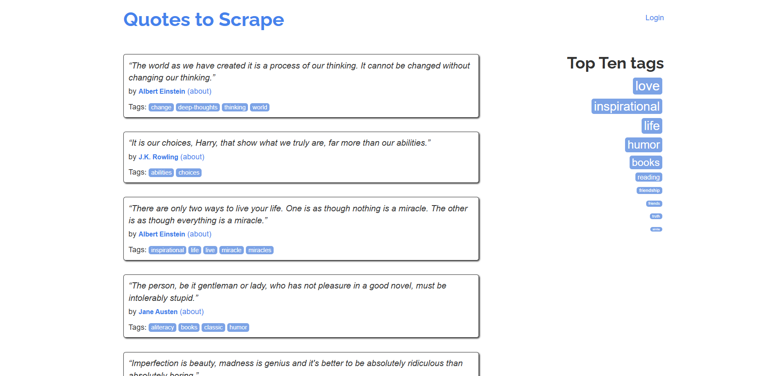

# 使用 Python 中的 AIOHTTP 进行网页爬虫

[](https://www.bright.cn/) 

本指南介绍了如何在 Python 中使用 AIOHTTP 进行网页爬虫的基础知识。

- [什么是 AIOHTTP？](#什么是-aiohttp)
- [使用 AIOHTTP 抓取：分步教程](#使用-aiohttp-抓取分步教程)
  - [步骤 1：设置抓取项目](#步骤-1设置抓取项目)
  - [步骤 2：设置抓取库](#步骤-2设置抓取库)
  - [步骤 3：获取目标页面的 HTML](#步骤-3获取目标页面的-html)
  - [步骤 4：解析 HTML](#步骤-4解析-html)
  - [步骤 5：编写数据提取逻辑](#步骤-5编写数据提取逻辑)
  - [步骤 6：导出抓取的数据](#步骤-6导出抓取的数据)
  - [步骤 7：整合所有代码](#步骤-7整合所有代码)
- [AIOHTTP 网页爬虫：高级功能与技巧](#aiohttp-网页爬虫高级功能与技巧)
  - [设置自定义请求头](#设置自定义请求头)
  - [设置自定义 User-Agent](#设置自定义-user-agent)
  - [设置 Cookie](#设置-cookie)
  - [集成代理](#集成代理)
  - [错误处理](#错误处理)
  - [重试失败的请求](#重试失败的请求)
- [AIOHTTP 与 Requests 网页爬虫对比](#aiohttp-与-requests-网页爬虫对比)
- [总结](#总结)

## 什么是 AIOHTTP？

[AIOHTTP](https://docs.aiohttp.org/en/stable/) 是一个基于 Python [`asyncio`](https://docs.python.org/3/library/asyncio.html) 库构建的异步客户端/服务器 HTTP 框架。与传统 HTTP 客户端不同，AIOHTTP 使用客户端会话管理多个请求之间的连接，因此非常适合高并发、基于会话的任务，并且效率极高。


**⚙️ 功能**

- 同时支持 HTTP 协议的客户端和服务器实现。  
- 原生支持客户端和服务器 WebSocket。  
- 提供用于构建 Web 服务器的中间件和可插拔路由。  
- 高效管理大型数据流。  
- 支持客户端会话持久化，可复用连接并减少多个请求产生的开销。  


## 使用 AIOHTTP 抓取：分步教程

在网页爬虫场景中，AIOHTTP 只是用于获取页面原始 HTML 内容的 HTTP 客户端。要解析该 HTML 并从中提取数据，你需要使用 [BeautifulSoup](https://www.crummy.com/software/BeautifulSoup/bs4/doc/) 等 HTML 解析器。

> **警告**：\
> 尽管 AIOHTTP 主要用于该流程的初始阶段，但本指南将带你了解完整的抓取工作流程。如果你想学习更高级的 AIOHTTP 网页爬虫技巧，可以在完成步骤 3 后直接跳到下一章。

### 步骤 1：设置抓取项目

安装 Python 3+，并为你的 AIOHTTP 抓取项目创建一个目录：

```bash
mkdir aiohttp-scraper
```

进入该目录并设置一个[虚拟环境](https://docs.python.org/3/library/venv.html)：

```bash
cd aiohttp-scraper
python -m venv env
```

在你常用的 Python IDE 中打开项目文件夹，然后在项目文件夹内创建一个名为 `scraper.py` 的文件。


在 IDE 的终端中激活虚拟环境。在 Linux 或 macOS 上，使用：

```bash
./env/bin/activate
```

在 Windows 上，运行：

```powershell
env/Scripts/activate
```

### 步骤 2：设置抓取库

安装 AIOHTTP 和 BeautifulSoup：

```bash
pip install aiohttp beautifulsoup4
```

将已安装的 [`aiohttp`](https://docs.aiohttp.org/en/stable/) 和 [`beautifulsoup4`](https://pypi.org/project/beautifulsoup4/) 依赖项导入你的 `scraper.py` 脚本：

```python
import asyncio
import aiohttp 
from bs4 import BeautifulSoup
```

> **注意**：\
> `aiohttp` 需要 `asyncio` 才能运行。

现在，将以下 `async` 函数工作流添加到你的 `scrper.py` 文件中：

```python
async def scrape_quotes():
    # Scraping logic...

# Run the asynchronous function
asyncio.run(scrape_quotes())
```

`scrape_quotes()` 定义了一个异步函数，你的抓取逻辑将在其中并发运行而不会阻塞。最后，`asyncio.run(scrape_quotes())` 会启动并运行该异步函数。

### 步骤 3：获取目标页面的 HTML

此示例说明如何从 [“Quotes to Scrape”](https://quotes.toscrape.com/) 网站抓取数据：



使用 Requests 或 AIOHTTP 等库时，直接发出 GET 请求即可获取页面的 HTML 内容。不过，AIOHTTP 使用的是[不同的请求生命周期](https://docs.aiohttp.org/en/stable/http_request_lifecycle.html)。  

AIOHTTP 的核心组件是 [`ClientSession`](https://docs.aiohttp.org/en/stable/client_reference.html)，它负责管理连接池，并默认支持 [`Keep-Alive`](https://developer.mozilla.org/en-US/docs/Web/HTTP/Headers/Keep-Alive)。它不会为每个请求打开新连接，而是复用现有连接，从而提升性能。

发出请求的过程通常包括三个关键步骤：

1. 通过 `ClientSession()` 打开会话。
2. 使用 [`session.get()`](https://docs.aiohttp.org/en/stable/client_reference.html#aiohttp.ClientSession.get) 异步发送 GET 请求。
3. 使用 `await response.text()` 等方法访问响应数据。

这种设计允许事件循环在操作之间使用不同的 [`with` 上下文](https://docs.python.org/3/reference/datamodel.html#context-managers)，而不会发生阻塞，因此非常适合高并发任务。

了解这一点后，你可以使用以下方法通过 AIOHTTP 获取主页的 HTML：

```python
async with aiohttp.ClientSession() as session:
    async with session.get("http://quotes.toscrape.com") as response:
        # Access the HTML of the target page
        html = await response.text()
```

在后台，AIOHTTP 会负责向服务器发送请求并等待服务器响应，响应中包含页面的 HTML 内容。收到响应后，`await response.text()` 方法会以字符串形式获取 HTML 内容。

打印 `html` 变量，你将看到：

```html
<!DOCTYPE html>
<html lang="en">
<head>
    <meta charset="UTF-8">
    <title>Quotes to Scrape</title>
    <link rel="stylesheet" href="/static/bootstrap.min.css">
    <link rel="stylesheet" href="/static/main.css">
</head>
<body>
    <!-- omitted for brevity... -->
</body>
</html>
```

### 步骤 4：解析 HTML

将 HTML 内容传递给 BeautifulSoup 构造函数进行解析：

```python
# Parse the HTML content using BeautifulSoup
soup = BeautifulSoup(html, "html.parser")
```

[`html.parser`](https://docs.python.org/3/library/html.parser.html) 是用于处理内容的默认 Python HTML 解析器。

`soup` 对象包含解析后的 HTML，并提供用于提取所需数据的方法。  

### 步骤 5：编写数据提取逻辑

可以使用以下代码从页面中抓取引语数据：

```python
# Where to store the scraped data
quotes = []

# Extract all quotes from the page
quote_elements = soup.find_all("div", class_="quote")

# Loop through quotes and extract text, author, and tags
for quote_element in quote_elements:
    text = quote_element.find("span", class_="text").get_text().get_text().replace("“", "").replace("”", "")
    author = quote_element.find("small", class_="author")
    tags = [tag.get_text() for tag in quote_element.find_all("a", class_="tag")]

    # Store the scraped data
    quotes.append({
        "text": text,
        "author": author,
        "tags": tags
    })
```

此代码片段初始化了一个名为 `quotes` 的列表，用于存储抓取的数据。它会找到所有引语 HTML 元素并逐一遍历，提取引语文本、作者和标签等详细信息。每条提取的引语都以字典形式存储在 `quotes` 列表中，以便轻松访问或导出数据。

### 步骤 6：导出抓取的数据

你可以使用以下代码将抓取的数据导出到 CSV 文件：

```python
# Open the file for export
with open("quotes.csv", mode="w", newline="", encoding="utf-8") as file:
    writer = csv.DictWriter(file, fieldnames=["text", "author", "tags"])
    
    # Write the header row
    writer.writeheader()
    
    # Write the scraped quotes data
    writer.writerows(quotes)
```

上述代码片段以写入模式打开名为 `quotes.csv` 的文件。然后设置列标题（`text`、`author`、`tags`），写入标题，接着将 `quotes` 列表中的每个字典写入 CSV 文件。

[`csv.DictWriter`](https://docs.python.org/3/library/csv.html#csv.DictWriter) 可简化数据格式化，让结构化数据更易于存储。要使用它，请从 Python 标准库导入 `csv`：

```python
import csv
```

### 步骤 7：整合所有代码

以下是完整的 AIOHTTP 网页爬虫脚本：

```python
import asyncio
import aiohttp
from bs4 import BeautifulSoup
import csv

# Define an asynchronous function to make the HTTP GET request
async def scrape_quotes():
    async with aiohttp.ClientSession() as session:
        async with session.get("http://quotes.toscrape.com") as response:
            # Access the HTML of the target page
            html = await response.text()

            # Parse the HTML content using BeautifulSoup
            soup = BeautifulSoup(html, "html.parser")

            # List to store the scraped data
            quotes = []

            # Extract all quotes from the page
            quote_elements = soup.find_all("div", class_="quote")

            # Loop through quotes and extract text, author, and tags
            for quote_element in quote_elements:
                text = quote_element.find("span", class_="text").get_text().replace("“", "").replace("”", "")
                author = quote_element.find("small", class_="author").get_text()
                tags = [tag.get_text() for tag in quote_element.find_all("a", class_="tag")]

                # Store the scraped data
                quotes.append({
                    "text": text,
                    "author": author,
                    "tags": tags
                })

            # Open the file name for export
            with open("quotes.csv", mode="w", newline="", encoding="utf-8") as file:
                writer = csv.DictWriter(file, fieldnames=["text", "author", "tags"])

                # Write the header row
                writer.writeheader()

                # Write the scraped quotes data
                writer.writerows(quotes)

# Run the asynchronous function
asyncio.run(scrape_quotes())
```

你可以使用以下命令运行它：

```bash
python scraper.py
```

或者，在 Linux/macOS 上：

```bash
python3 scraper.py
```

项目的根文件夹中将出现一个 `quotes.csv` 文件。打开它，你将看到：


## AIOHTTP 网页爬虫：高级功能与技巧

在以下示例中，目标网站将是 [HTTPBin.io 的 `/anything` 端点](https://httpbin.io/anything)。此 API 会返回请求方发送的 IP 地址、请求头和其他数据。

### 设置自定义请求头

你可以通过 `headers` 参数在 AIOHTTP 请求中[指定自定义请求头](https://docs.aiohttp.org/en/stable/client_advanced.html#custom-request-headers)：

```python
import aiohttp
import asyncio

async def fetch_with_custom_headers():
    # Custom headers for the request
    headers = {
        "Accept": "application/json",
        "Accept-Language": "en-US,en;q=0.9,fr-FR;q=0.8,fr;q=0.7,es-US;q=0.6,es;q=0.5,it-IT;q=0.4,it;q=0.3"
    }

    async with aiohttp.ClientSession() as session:
        # Make a GET request with custom headers
        async with session.get("https://httpbin.io/anything", headers=headers) as response:
            data = await response.json()
            # Handle the response...
            print(data)

# Run the event loop
asyncio.run(fetch_with_custom_headers())
```

这样，AIOHTTP 将发出设置了 [`Accept`](https://developer.mozilla.org/en-US/docs/Web/HTTP/Headers/Accept) 和 [`Accept-Language`](https://developer.mozilla.org/en-US/docs/Web/HTTP/Headers/Accept-Language) 请求头的 GET HTTP 请求。

### 设置自定义 User-Agent

[`User-Agent`](https://developer.mozilla.org/en-US/docs/Web/HTTP/Headers/User-Agent) 是[网页爬虫 HTTP 请求头](https://www.bright.cn/blog/web-data/http-headers-for-web-scraping)中最关键的请求头之一。默认情况下，AIOHTTP 使用以下 `User-Agent`：

```
Python/<PYTHON_VERSION> aiohttp/<AIOHTTP_VERSION>
```

上述默认值会使你的请求很容易被识别为来自自动化脚本，从而增加被目标网站封禁的可能性。

为降低被检测到的概率，你可以像之前一样设置一个来自真实环境的自定义 `User-Agent`：

```python
import aiohttp
import asyncio

async def fetch_with_custom_user_agent():
    # Define a Chrome-like custom User-Agent
    headers = {
        "User-Agent": "Mozilla/5.0 (Windows NT 10.0; Win64; x64) AppleWebKit/537.36 (KHTML, like Gecko) Chrome/132.0.0.0 Safari/537.36"
    }

    async with aiohttp.ClientSession(headers=headers) as session:
        # Make a GET request with the custom User-Agent
        async with session.get("https://httpbin.io/anything") as response:
            data = await response.text()
            # Handle the response...
            print(data)

# Run the event loop
asyncio.run(fetch_with_custom_user_agent())
```

### 设置 Cookie

与 HTTP 请求头一样，你可以使用 `ClientSession()` 中的 `cookies` [设置自定义 Cookie](https://docs.aiohttp.org/en/v3.7.3/client_advanced.html#custom-cookies)：

```python
import aiohttp
import asyncio

async def fetch_with_custom_cookies():
    # Define cookies as a dictionary
    cookies = {
        "session_id": "9412d7hdsa16hbda4347dagb",
        "user_preferences": "dark_mode=false"
    }

    async with aiohttp.ClientSession(cookies=cookies) as session:
        # Make a GET request with custom cookies
        async with session.get("https://httpbin.io/anything") as response:
            data = await response.text()
            # Handle the response...
            print(data)

# Run the event loop
asyncio.run(fetch_with_custom_cookies())
```

Cookie 允许你加入网页爬虫请求所需的会话数据。

> **注意**：\
> 在 `ClientSession` 中设置的 Cookie 会在该会话发出的所有请求之间共享。要访问会话 Cookie，请参阅 [`ClientSession.cookie_jar`](https://docs.aiohttp.org/en/v3.7.3/client_reference.html#aiohttp.ClientSession.cookie_jar)。

### 集成代理

在 AIOHTTP 中，你可以通过代理服务器路由请求，以降低 IP 被封禁的风险。为此，请在 `session` 的 HTTP 方法函数中使用 [`proxy` 参数](https://docs.aiohttp.org/en/v3.7.3/client_advanced.html#proxy-support)：

```python
import aiohttp
import asyncio

async def fetch_through_proxy():
    # Replace with the URL of your proxy server
    proxy_url = "<YOUR_PROXY_URL>"

    async with aiohttp.ClientSession() as session:
        # Make a GET request through the proxy server
        async with session.get("https://httpbin.io/anything", proxy=proxy_url) as response:
            data = await response.text()
            # Handle the response...
            print(data)

# Run the event loop
asyncio.run(fetch_through_proxy())
```

### 错误处理

默认情况下，AIOHTTP 仅在出现连接或网络问题时抛出错误。要在收到 [`4xx`](https://developer.mozilla.org/en-US/docs/Web/HTTP/Status#client_error_responses) 和 [`5xx`](https://developer.mozilla.org/en-US/docs/Web/HTTP/Status#server_error_responses) 状态码时针对 HTTP 响应抛出异常，可以使用以下任一方法：

1. **创建 `ClientSession` 时设置 `raise_for_status=True`**：如果响应状态为 `4xx` 或 `5xx`，自动为通过该会话发出的所有请求抛出异常。
2. **将 `raise_for_status=True` 直接传递给请求方法**：为单个请求方法（如 `session.get()` 或 `session.post()`）启用错误抛出，而不会影响其他方法。
3. **手动调用 `response.raise_for_status()`**：完全控制何时抛出异常，让你可以针对每个请求单独决定。

选项 1 示例：

```python
import aiohttp
import asyncio

async def fetch_with_session_error_handling():
    async with aiohttp.ClientSession(raise_for_status=True) as session:
        try:
            async with session.get("https://httpbin.io/anything") as response:
                # No need to call response.raise_for_status(), as it is automatic
                data = await response.text()
                print(data)
        except aiohttp.ClientResponseError as e:
            print(f"HTTP error occurred: {e.status} - {e.message}")
        except aiohttp.ClientError as e:
            print(f"Request error occurred: {e}")

# Run the event loop
asyncio.run(fetch_with_session_error_handling())
```

在会话级别设置 `raise_for_status=True` 后，通过该会话发出的所有请求都会针对 `4xx` 或 `5xx` 响应抛出 `aiohttp.ClientResponseError`。

选项 2 示例：

```python
import aiohttp
import asyncio

async def fetch_with_raise_for_status():
    async with aiohttp.ClientSession() as session:
        try:
            async with session.get("https://httpbin.io/anything", raise_for_status=True) as response:
                # No need to manually call response.raise_for_status(), it is automatic
                data = await response.text()
                print(data)
        except aiohttp.ClientResponseError as e:
            print(f"HTTP error occurred: {e.status} - {e.message}")
        except aiohttp.ClientError as e:
            print(f"Request error occurred: {e}")

# Run the event loop
asyncio.run(fetch_with_raise_for_status())
```

在这种情况下，`raise_for_status=True` 参数会直接传递给 `session.get()` 调用。这样可以确保针对任何 `4xx` 或 `5xx` 状态码自动抛出异常。

选项 3 示例：

```python
import aiohttp
import asyncio

async def fetch_with_manual_error_handling():
    async with aiohttp.ClientSession() as session:
        try:
            async with session.get("https://httpbin.io/anything") as response:
                response.raise_for_status()  # Manually raises error for 4xx/5xx
                data = await response.text()
                print(data)
        except aiohttp.ClientResponseError as e:
            print(f"HTTP error occurred: {e.status} - {e.message}")
        except aiohttp.ClientError as e:
            print(f"Request error occurred: {e}")

# Run the event loop
asyncio.run(fetch_with_manual_error_handling())
```

如果你希望更精细地控制各个请求，可以在发出请求后手动调用 `response.raise_for_status()`。此方法让你能够准确决定处理错误的时机。  


### 重试失败的请求

AIOHTTP 不提供自动重试请求的内置支持。要实现此功能，你必须使用自定义逻辑或 [`aiohttp-retry`](https://github.com/inyutin/aiohttp_retry) 等第三方库。这样，你就能为失败的请求配置重试逻辑，帮助处理暂时性网络问题、超时或速率限制。

安装 [`aiohttp-retry`](https://pypi.org/project/aiohttp-retry/)：

```bash
pip install aiohttp-retry
```

在代码中使用它：

```python
import asyncio
from aiohttp_retry import RetryClient, ExponentialRetry

async def main():
    retry_options = ExponentialRetry(attempts=1)
    retry_client = RetryClient(raise_for_status=False, retry_options=retry_options)
    async with retry_client.get("https://httpbin.io/anything") as response:
        print(response.status)
        
    await retry_client.close()
```

这会使用指数退避策略配置重试行为。更多信息请参阅[官方文档](https://github.com/inyutin/aiohttp_retry?tab=readme-ov-file#documentation)。

## AIOHTTP 与 Requests 网页爬虫对比

下表概括比较了 AIOHTTP 与 [Requests 在网页爬虫方面的表现](https://www.bright.cn/blog/web-data/python-requests-guide)：

| **功能** | **AIOHTTP** | **Requests** |
| --- | --- | --- |
| **GitHub 星标数** | 15.3k | 52.4k |
| **客户端支持** | ✔️  | ✔️  |
| **同步支持** | ❌   | ✔️  |
| **异步支持** | ✔️  | ❌   |
| **服务器支持** | ✔️  | ❌   |
| **连接池** | ✔️  | ✔️  |
| **HTTP/2 支持** | ❌   | ❌   |
| **User-Agent 自定义** | ✔️  | ✔️  |
| **代理支持** | ✔️  | ✔️  |
| **Cookie 处理** | ✔️  | ✔️  |
| **重试机制** | 仅可通过第三方库实现 | 可通过 `HTTPAdapter` 实现 |
| **性能** | 高 | 中等 |
| **社区支持度和受欢迎程度** | 中等 | 庞大 |

如需完整对比，请查看我们的 [Requests、HTTPX 与 AIOHTTP 对比](https://www.bright.cn/blog/web-data/requests-vs-httpx-vs-aiohttp)博文。

## 总结

AIOHTTP 是一种快速可靠的工具，可通过发出 HTTP 请求采集在线数据。然而，自动化 HTTP 请求可能会暴露你的公网 IP 地址。为保护你的隐私和安全，可以考虑使用 Bright Data 的代理服务器来隐藏你的 IP 地址。

- [数据中心代理](https://www.bright.cn/proxy-types/datacenter-proxies)：超过 770,000 个数据中心 IP。
- [住宅代理](https://www.bright.cn/proxy-types/residential-proxies)：覆盖 195 多个国家/地区的 7200 多万个住宅 IP。
- [ISP 代理](https://www.bright.cn/proxy-types/isp-proxies)：超过 700,000 个 ISP IP。

立即创建免费的 Bright Data 账户，测试我们的代理和抓取解决方案！
